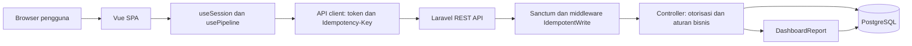
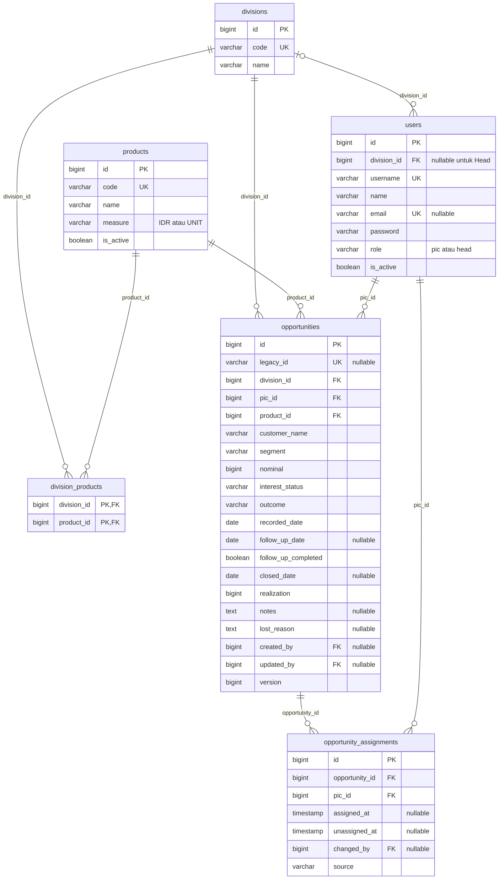
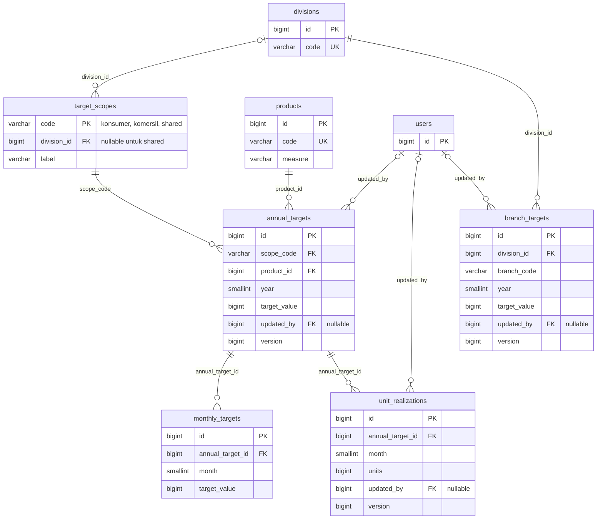
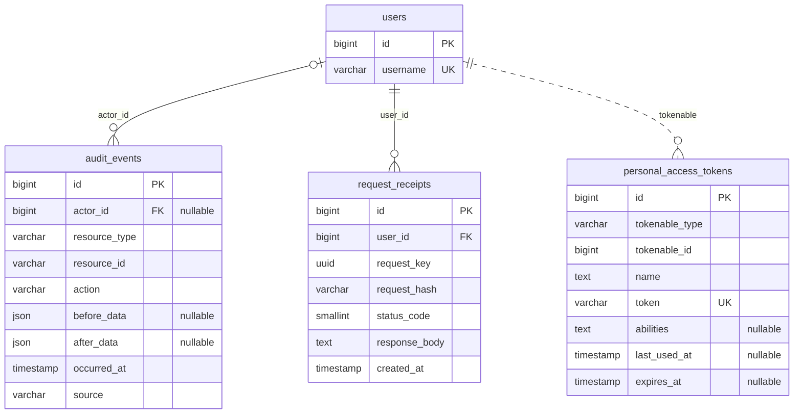
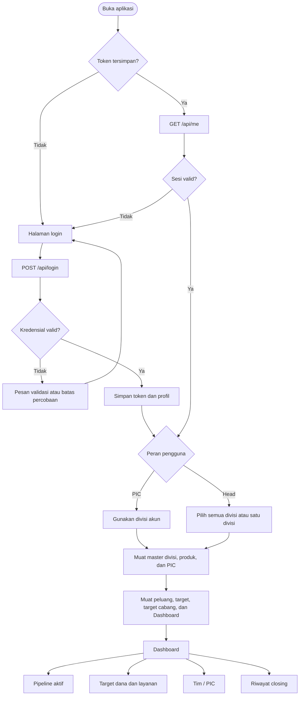
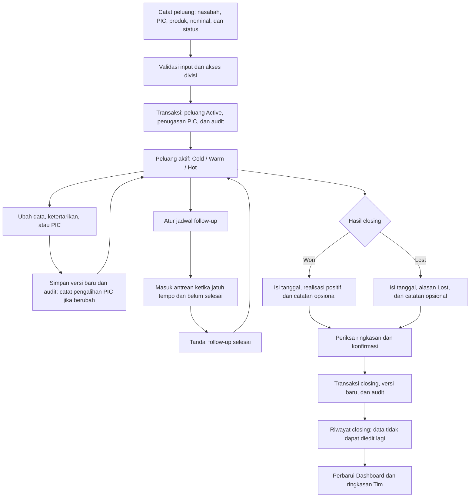

# Pipeline Management System

Aplikasi pengelolaan pipeline funding untuk divisi **Konsumer** dan **Komersil**.
Sistem mencatat peluang nasabah, penanggung jawab (PIC), jadwal tindak lanjut,
hasil closing, serta pencapaian target dana dan layanan dalam satu aplikasi.
Head Funding dapat memantau kedua divisi, sedangkan PIC bekerja dalam cakupan
divisi akun masing-masing.

Dokumentasi ini mengikuti halaman frontend, route API, aturan controller, dan
migration yang tersedia di repositori.

## Daftar isi

- [Teknologi dan arsitektur](#teknologi-dan-arsitektur)
- [Peran dan hak akses](#peran-dan-hak-akses)
- [Produk dan cakupan target](#produk-dan-cakupan-target)
- [Rincian fitur](#rincian-fitur)
- [Aturan bisnis dan perhitungan](#aturan-bisnis-dan-perhitungan)
- [ERD database](#erd-database)
- [Alur aplikasi](#alur-aplikasi)
- [Ringkasan REST API](#ringkasan-rest-api)
- [Struktur proyek](#struktur-proyek)
- [Menjalankan secara lokal](#menjalankan-secara-lokal)
- [Build dan pengujian](#build-dan-pengujian)
- [Berkas lokal dan dokumentasi lanjutan](#berkas-lokal-dan-dokumentasi-lanjutan)

## Teknologi dan arsitektur

| Lapisan     | Teknologi                                   | Fungsi                                                                             |
| ----------- | ------------------------------------------- | ---------------------------------------------------------------------------------- |
| Antarmuka   | Vue 3, Vue Router 4, Vite 7                 | SPA, navigasi, formulir, dan pengelolaan state melalui composable                  |
| Visualisasi | Chart.js 4                                  | Grafik target/realisasi, komposisi status, tren bulanan, dan distribusi produk PIC |
| Backend     | PHP 8.2+, Laravel 12                        | REST API, validasi, otorisasi divisi, transaksi, dan laporan                       |
| Autentikasi | Laravel Sanctum 4                           | Bearer token untuk akses API                                                       |
| Database    | PostgreSQL                                  | Penyimpanan data operasional, target, audit, dan hasil permintaan tulis            |
| Pengujian   | Node.js test runner, PHPUnit 11, Playwright | Pengujian logika frontend, API, serta alur dan tampilan browser                    |



Data operasional disimpan di backend. Browser menyimpan token autentikasi dan
state tampilan; filter daftar juga dicatat pada query URL. Laporan Dashboard
dihitung oleh backend, sedangkan halaman Tim menyusun ringkasan dari data
peluang dan master PIC yang telah dimuat.

## Peran dan hak akses

| Kemampuan                                         | PIC (`pic`)                                                               | Head Funding (`head`)                                           |
| ------------------------------------------------- | ------------------------------------------------------------------------- | --------------------------------------------------------------- |
| Membaca peluang, riwayat, dan PIC                 | Seluruh data dalam divisi akun                                            | Seluruh divisi atau satu divisi pilihan                         |
| Membuat, mengedit, follow-up, dan closing peluang | Peluang dalam divisi akun, termasuk milik PIC lain dalam divisi yang sama | Peluang pada divisi yang dipilih                                |
| Mengatur target produk divisi                     | Divisi akun                                                               | Kedua divisi; pilih satu divisi pada antarmuka sebelum mengedit |
| Membaca Dashboard dan ringkasan Tim               | Divisi akun                                                               | Gabungan kedua divisi atau per divisi                           |
| Mengatur target dan realisasi CMS                 | Target bersama pada scope `shared`                                        | Target bersama pada scope `shared`                              |

Pembatasan divisi ditegakkan di backend. Pada tampilan **Semua Divisi**, Head
mendapat ringkasan gabungan; pengeditan peluang dan target divisi memerlukan
pemilihan satu divisi. CMS tetap menggunakan satu target bersama.

## Produk dan cakupan target

| Produk       | Kode API       | Satuan         | Konsumer | Komersil | Scope target |
| ------------ | -------------- | -------------- | -------- | -------- | ------------ |
| Tabungan     | `tabungan`     | Rupiah (`IDR`) | Ya       | Ya       | Per divisi   |
| Giro         | `giro`         | Rupiah (`IDR`) | Tidak    | Ya       | `komersil`   |
| Deposito     | `deposito`     | Rupiah (`IDR`) | Ya       | Ya       | Per divisi   |
| Bale Syariah | `bale-syariah` | Unit (`UNIT`)  | Ya       | Tidak    | `konsumer`   |
| QRIS         | `qris`         | Unit (`UNIT`)  | Ya       | Tidak    | `konsumer`   |
| CMS          | `cms`          | Unit (`UNIT`)  | Ya       | Ya       | `shared`     |

Peluang nasabah hanya menggunakan produk `IDR`. Realisasi dana berasal dari
closing **Won**, sedangkan realisasi layanan dicatat manual per bulan.
CMS menggunakan satu record target per tahun yang dibaca dan dikelola kedua
divisi, sehingga tidak menjadi dua target terpisah.

## Rincian fitur

### 1. Login dan sesi pengguna

- Login menggunakan username dan password akun aktif; percobaan login dibatasi
  10 permintaan per menit.
- Token Sanctum dikirim sebagai `Authorization: Bearer <token>` untuk API
  terproteksi. Login baru mencabut seluruh token lama milik akun tersebut.
- Opsi **Ingat saya** menyimpan token pada `localStorage`; sesi biasa memakai
  `sessionStorage`. Profil dipulihkan melalui `/api/me` saat aplikasi dibuka kembali.
- Router melindungi halaman internal. Respons `401` membersihkan sesi frontend
  dan mengarahkan pengguna ke halaman login.
- Logout mencabut token yang sedang dipakai dan membersihkan sesi browser.

### 2. Dashboard (`/#/`)

- Kartu jumlah peluang aktif, nominal potensi aktif, jumlah dan nominal peluang
  **Hot**, serta realisasi Won pada tahun pilihan.
- Ringkasan target dan realisasi tahunan per produk dana: target, realisasi,
  persentase pencapaian, progress bar, dan sisa target.
- Grafik perbandingan target dengan realisasi, distribusi **Cold/Warm/Hot**,
  serta tren nominal peluang tercatat dan realisasi Won per bulan.
- Antrean follow-up yang jatuh tempo hari ini atau terlambat; ringkasan menampilkan
  maksimal lima peluang terawal beserta akses ke detail dan daftar follow-up.
- Ringkasan target layanan dalam unit, termasuk pencapaian tahunan dan rincian
  bulan yang dipilih.
- Tautan dari target dana yang belum ditetapkan langsung membuka formulir Target
  untuk produk dan tahun terkait.

### 3. Pipeline aktif (`/#/pipeline`)

- Membuat dan mengubah peluang dengan nama nasabah, PIC, produk, segmen,
  nominal potensi, status ketertarikan, tanggal pencatatan, jadwal follow-up,
  dan catatan.
- Mengalihkan PIC dalam divisi yang sama sambil menyimpan riwayat penugasan lama.
- Mencari berdasarkan nasabah, PIC, atau produk; memfilter PIC, produk,
  status ketertarikan, dan follow-up jatuh tempo.
- Mengurutkan berdasarkan pembaruan terbaru, nominal terbesar, atau jadwal
  follow-up; daftar ditampilkan delapan peluang per halaman.
- Pencarian, filter, urutan, dan halaman tersimpan pada query URL sehingga dapat
  dipulihkan setelah refresh atau navigasi kembali.
- Tampilan tabel pada layar lebar dan kartu pada layar kecil; detail dan formulir
  dibuka melalui drawer.

### 4. Follow-up dan closing

- Menjadwalkan dan menandai follow-up selesai tanpa menutup peluang.
- Perubahan tanggal follow-up mengembalikan penanda penyelesaian menjadi belum
  selesai, sehingga jadwal baru dapat ditindaklanjuti.
- Closing **Won** mencatat tanggal closing, realisasi dana, dan catatan opsional.
- Closing **Lost** mencatat tanggal closing, alasan kehilangan, dan catatan opsional;
  realisasi disimpan sebagai nol.
- Ringkasan closing diperiksa sebelum konfirmasi. Setelah berhasil, peluang
  keluar dari daftar aktif dan muncul pada Riwayat.

### 5. Target dana dan layanan (`/#/target`)

- Menetapkan target tahunan dana per produk dan divisi, dengan pilihan tahun.
- Menyimpan beberapa target produk sekaligus melalui satu batch transaksi.
- Menampilkan total target, realisasi Won, persentase pencapaian, dan sisa target.
- Mengelola target tahunan layanan serta target dan realisasi unit untuk 12 bulan.
- Menampilkan CMS sebagai target bersama lintas divisi.
- Backend juga menyediakan target dana bulanan dan target cabang melalui API;
  formulir target dana pada halaman ini berfokus pada target tahunan produk.

### 6. Tim / PIC (`/#/tim`)

- Ringkasan setiap PIC: jumlah dan nominal peluang aktif, jumlah Won/Lost,
  serta realisasi Won pada tahun pilihan.
- Pencarian nama PIC dan pengurutan menurut potensi aktif terbesar, realisasi
  terbesar, atau nama.
- Detail komposisi produk berdasarkan potensi aktif atau realisasi Won.
- Daftar peluang yang sedang maupun pernah ditangani PIC, termasuk peluang
  yang telah dialihkan ke PIC lain; setiap peluang dapat dibuka detailnya.

### 7. Riwayat closing dan audit (`/#/history`)

- Daftar peluang Won/Lost, dengan pencarian, filter PIC/produk/hasil closing,
  rentang tanggal closing, pengurutan, dan paginasi.
- Detail hasil closing menampilkan nominal potensi, realisasi atau alasan Lost,
  PIC, tanggal, serta catatan.
- Timeline peluang menampilkan pembuatan, perubahan, penyelesaian follow-up,
  dan closing beserta pelaku, waktu, serta snapshot sebelum/sesudah.
- Audit target tahunan, realisasi unit, dan target cabang juga disimpan di backend.

### 8. Validasi dan keandalan penyimpanan

- Validasi formulir, pesan kesalahan per kolom, pemisah ribuan pada input rupiah,
  dan konfirmasi ketika meninggalkan perubahan yang belum disimpan.
- Tombol dan formulir dilindungi selama proses simpan untuk mengurangi kiriman ganda.
- Field `version` mencegah isian lama menimpa perubahan pengguna lain. Konflik
  menghasilkan `409` dan antarmuka menyediakan pemuatan data terbaru.
- Transaksi database menjaga perubahan peluang/penugasan/audit serta batch
  target/realisasi tetap konsisten jika salah satu langkah gagal.
- `Idempotency-Key` memungkinkan retry permintaan tulis tanpa menggandakan hasil.
  Jika jaringan putus atau timeout, klien mempertahankan key dan payload asli
  selama hasil penyimpanan belum pasti.
- Respons dari konteks akun, divisi, atau tahun yang sudah berubah diabaikan agar
  data lama tidak menimpa tampilan terbaru.

## Aturan bisnis dan perhitungan

| Area           | Aturan yang diterapkan                                                                                                                                  |
| -------------- | ------------------------------------------------------------------------------------------------------------------------------------------------------- |
| Status peluang | `outcome`: `Active`, `Won`, atau `Lost`; `interest_status`: `Cold`, `Warm`, atau `Hot`. Keduanya memiliki fungsi berbeda.                               |
| Segmen         | Peluang baru menggunakan `Mid` atau `Large`. `Small` hanya dipertahankan untuk pembaruan data lama yang sudah memakai segmen tersebut.                  |
| PIC dan produk | PIC harus aktif, memiliki role `pic`, dan berasal dari divisi peluang. Produk peluang harus aktif, bersatuan `IDR`, dan tersedia pada divisi tersebut.  |
| Nominal        | Nominal potensi berupa rupiah bulat lebih dari nol. Target dan realisasi unit berupa bilangan bulat minimal nol.                                        |
| Tanggal        | Tanggal pencatatan tidak melewati hari ini; follow-up tidak mendahului pencatatan; tanggal closing berada antara tanggal pencatatan dan hari ini.       |
| Won            | Realisasi wajib lebih dari nol dan boleh melebihi nominal potensi. Nominal potensi asli tetap disimpan.                                                 |
| Lost           | Alasan wajib diisi; realisasi ditetapkan nol oleh backend.                                                                                              |
| Closing final  | Peluang Won/Lost tidak dapat diedit atau ditutup ulang melalui API yang tersedia.                                                                       |
| Periode aktif  | Jumlah, nominal, status ketertarikan, dan antrean follow-up peluang aktif mencakup seluruh periode.                                                     |
| Periode hasil  | Won/Lost dan realisasi dana tahunan mengikuti tahun `closed_date`, bukan tahun pencatatan.                                                              |
| Tren bulanan   | Nominal peluang mengikuti `recorded_date`; realisasi Won mengikuti `closed_date`. Bulan mendatang bernilai `null` pada laporan Dashboard.               |
| Capaian target | `realisasi / target × 100%`; jika target nol, persentase bernilai `null` dan ditampilkan sebagai target belum ditetapkan.                               |
| Sisa target    | `max(0, target − realisasi)`. Realisasi tahunan layanan adalah jumlah realisasi unit bulanan.                                                           |
| Tahun target   | Tahun yang diterima API berada pada rentang 2000–2100.                                                                                                  |
| Target bulanan | Jika rincian bulanan dikirim, harus berisi 12 bulan unik. Pembaruan target tahunan tanpa field `monthly` mempertahankan rincian bulanan yang sudah ada. |

Contoh: peluang Tabungan berpotensi Rp1 miliar dapat ditutup Won dengan
realisasi Rp1,2 miliar. Laporan menghitung Rp1,2 miliar sebagai realisasi pada
tahun closing, sementara nominal potensi tetap Rp1 miliar.

## ERD database

Sumber skema: [migration database](src/backend/database/migrations/).
Diagram Mermaid berikut memisahkan kelompok relasi agar mudah dibaca.
`PK` berarti primary key, `FK` foreign key, dan `UK` unique key. Kolom yang
ditampilkan adalah kolom utama; timestamp standar dan sebagian kolom autentikasi
tidak ditampilkan. Nama tabel dan kolom mengikuti migration.

### 1. Divisi, produk, peluang, dan penugasan PIC



Relasi `users.division_id` bersifat opsional: Head dapat tidak memiliki divisi,
sehingga satu pengguna dapat berelasi ke nol atau satu divisi.
Kolom `created_by`, `updated_by`, dan `changed_by` juga mengarah ke `users.id`;
garisnya tidak diulang agar diagram tetap terbaca.

### 2. Target dan realisasi



Target dana dan layanan memakai `annual_targets` yang sama; satuan ditentukan
oleh `products.measure`. Realisasi dana dihitung dari `opportunities`, sedangkan
realisasi layanan disimpan di `unit_realizations`. `branch_targets` menyimpan
target cabang tersendiri menggunakan kode cabang; skema belum memiliki tabel
master cabang atau relasi cabang pada peluang.

### 3. Token, audit, dan pencatatan permintaan



Relasi Sanctum `tokenable_type`/`tokenable_id` adalah relasi polimorfik Eloquent,
bukan foreign key langsung pada database. Demikian pula pasangan
`audit_events.resource_type`/`resource_id` menunjuk sumber daya secara logis tanpa
foreign key fisik; `actor_id` tetap merupakan foreign key ke pengguna.

### Fungsi tabel dan batasan integritas

| Tabel                     | Tanggung jawab                              | Identitas unik selain `id`                             |
| ------------------------- | ------------------------------------------- | ------------------------------------------------------ |
| `divisions`               | Master divisi                               | `code`                                                 |
| `users`                   | Akun, role, dan keanggotaan divisi          | `username`, `email` jika diisi                         |
| `products`                | Master produk beserta satuan                | `code`                                                 |
| `division_products`       | Produk yang tersedia bagi tiap divisi       | Primary key gabungan `division_id + product_id`        |
| `opportunities`           | Kondisi terkini dan hasil peluang           | `legacy_id` jika diisi                                 |
| `opportunity_assignments` | Riwayat penugasan dan pengalihan PIC        | Primary key `id`                                       |
| `target_scopes`           | Cakupan target divisi atau bersama          | Primary key `code`                                     |
| `annual_targets`          | Target per scope, produk, dan tahun         | `scope_code + product_id + year`                       |
| `monthly_targets`         | Rincian target bulanan                      | `annual_target_id + month`                             |
| `unit_realizations`       | Realisasi layanan bulanan dan versinya      | `annual_target_id + month`                             |
| `branch_targets`          | Target cabang per divisi dan tahun          | `division_id + branch_code + year`                     |
| `audit_events`            | Pelaku, aksi, waktu, dan snapshot perubahan | Primary key `id`; indeks `resource_type + resource_id` |
| `request_receipts`        | Respons sukses untuk pengulangan permintaan | `user_id + request_key`                                |
| `personal_access_tokens`  | Token Sanctum                               | `token`                                                |

Relasi master divisi/PIC/produk yang dipakai peluang menggunakan
`restrictOnDelete`. Penghapusan peluang menghapus riwayat penugasannya;
penghapusan target tahunan menghapus target bulanan dan realisasi unit.
Referensi pelaku yang nullable menggunakan `nullOnDelete`, sehingga catatan
bisnis dapat dipertahankan tanpa akun pelaku.

Tabel infrastruktur Laravel yang tidak dirinci pada ERD di atas:

| Tabel                                | Kegunaan                                                                                             |
| ------------------------------------ | ---------------------------------------------------------------------------------------------------- |
| `password_reset_tokens`              | Penyimpanan token reset password bawaan Laravel; route reset password belum tersedia pada API proyek |
| `sessions`                           | Penyimpanan sesi database; autentikasi SPA ini menggunakan bearer token                              |
| `cache`, `cache_locks`               | Cache dan penguncian cache                                                                           |
| `jobs`, `job_batches`, `failed_jobs` | Infrastruktur antrean pekerjaan dan pencatatan kegagalan                                             |
| `migrations`                         | Riwayat migration yang dikelola Laravel                                                              |

## Alur aplikasi

### 1. Login, pemuatan data, dan navigasi



Saat divisi atau tahun diganti, frontend memuat ulang data sesuai konteks.
Peluang tetap dimuat lintas periode; filter tahun memengaruhi target dan
perhitungan hasil closing. Semua halaman internal memerlukan sesi valid.

### 2. Siklus peluang dan tindak lanjut



Penyelesaian follow-up mempertahankan `outcome = Active`. Status ketertarikan
dapat diubah selama peluang aktif; API tidak mewajibkan urutan Cold → Warm → Hot
sebelum closing. Setiap perubahan harus membawa `version` terbaru.

### 3. Pengelolaan target dan realisasi

1. Pilih tahun dan divisi. Untuk CMS, aplikasi menggunakan scope `shared`.
2. Untuk produk dana, isi target tahunan masing-masing produk. Untuk layanan,
   isi target tahunan beserta target dan realisasi unit Januari–Desember.
3. Frontend mengirim `/api/targets/batch` beserta versi target dan, untuk layanan,
   versi realisasi bulanan. Record baru menggunakan `version = 0`.
4. Backend memvalidasi scope, akses divisi, produk, nilai, dan kelengkapan bulan,
   lalu mengunci data terkait dan memeriksa versi di dalam transaksi.
5. Semua target, realisasi unit, dan audit disimpan bersama. Konflik versi
   membatalkan seluruh batch dan mengembalikan `409`.
6. Antarmuka memperbarui target dan laporan. Realisasi dana dihitung dari Won
   pada tahun closing; realisasi layanan dijumlahkan dari input bulanan.

### 4. Penyimpanan, retry, dan konflik

```mermaid
sequenceDiagram
    actor User as Pengguna
    participant UI as Vue dan API client
    participant API as Laravel API
    participant DB as PostgreSQL
    User->>UI: Simpan formulir
    UI->>API: Payload, bearer token, version, Idempotency-Key
    API->>API: Autentikasi dan pemeriksaan key
    API->>DB: Mulai transaksi; kunci akun dan cari receipt
    alt Key dan permintaan identik sudah tersimpan
        DB-->>API: Respons sukses sebelumnya
        API-->>UI: Respons lama dan Idempotency-Replayed: true
    else Key sama untuk method, path, atau body berbeda
        API-->>UI: 409 konflik permintaan
    else Key baru
        API->>API: Otorisasi dan validasi aturan bisnis
        API->>DB: Kunci record dan periksa version
        alt Version sesuai dan data valid
            API->>DB: Simpan data bisnis, audit, dan receipt sukses
            DB-->>API: Commit
            API-->>UI: Respons sukses
        else Version berbeda atau data tidak valid
            API->>DB: Rollback
            API-->>UI: 409 konflik versi atau 422 validasi
        end
    end
    UI-->>User: Tampilkan hasil atau langkah perbaikan
```

Jika hasil simpan belum pasti karena koneksi terputus, pengguna dapat mencoba
lagi dengan key dan isi permintaan yang sama. Header `Idempotency-Key` berupa
UUID; antarmuka mengirimkannya untuk penyimpanan, sedangkan API masih menerima
klien lama tanpa header tersebut. `request_hash` mengikat key ke method, path,
dan body persis seperti yang diterima server.

## Ringkasan REST API

Base path: `/api`. Selain `POST /login`, seluruh endpoint berikut memerlukan
bearer token. Hak akses divisi tetap diperiksa pada backend.

| Metode  | Endpoint                                              | Fungsi                                                         |
| ------- | ----------------------------------------------------- | -------------------------------------------------------------- |
| `POST`  | `/login`                                              | Login dan penerbitan token                                     |
| `GET`   | `/me`                                                 | Profil pengguna dan divisi                                     |
| `POST`  | `/logout`                                             | Pencabutan token aktif                                         |
| `GET`   | `/divisions`, `/products`, `/pics`                    | Data master sesuai akses pengguna                              |
| `GET`   | `/opportunities`                                      | Daftar peluang, filter, pengurutan, dan paginasi               |
| `POST`  | `/opportunities`                                      | Membuat peluang aktif                                          |
| `GET`   | `/opportunities/{id}`                                 | Detail, penugasan, dan timeline audit                          |
| `PATCH` | `/opportunities/{id}`                                 | Mengubah peluang aktif                                         |
| `POST`  | `/opportunities/{id}/follow-up-completion`            | Menyelesaikan follow-up                                        |
| `POST`  | `/opportunities/{id}/closing`                         | Closing Won atau Lost                                          |
| `GET`   | `/targets`                                            | Target tahunan beserta target bulanan dan realisasi unit       |
| `POST`  | `/targets/batch`                                      | Menyimpan beberapa target dan rincian bulanannya secara atomik |
| `PUT`   | `/targets/{scope}/{product}/{year}`                   | Membuat atau memperbarui satu target                           |
| `PUT`   | `/unit-realizations/{scope}/{product}/{year}/{month}` | Mencatat realisasi unit bulanan                                |
| `GET`   | `/branch-targets`                                     | Target cabang                                                  |
| `PUT`   | `/branch-targets/{division}/{branch}/{year}`          | Membuat atau memperbarui target cabang                         |
| `GET`   | `/dashboard`                                          | Agregasi Dashboard per tahun dan cakupan divisi                |
| `GET`   | `/team`                                               | Ringkasan PIC dari backend untuk seluruh periode               |
| `GET`   | `/pics/{id}/opportunities`                            | Peluang yang sedang atau pernah ditangani PIC                  |

Parameter penting:

- `/opportunities`: `division_id`, `outcome[]`, `pic_id`, `product_id`, `search`,
  `sort`, `direction`, `page`, dan `per_page` (maksimal 100).
  Pencarian API memakai nama nasabah atau `legacy_id`; pencarian UI juga mencakup
  PIC dan produk melalui data yang dimuat frontend.
- `/dashboard`: `year` dan `division_id` opsional. PIC selalu dibatasi divisi akun.
- `/targets`: `year` wajib dan `scope` opsional (`konsumer`, `komersil`, `shared`).
- `/branch-targets`: `year` wajib dan `division_id` opsional.
- Placeholder `{product}` dan `{division}` pada route target memakai kode master,
  misalnya `tabungan` dan `komersil`; `{id}` peluang memakai ID numerik.

Endpoint `/team` menghitung seluruh periode. Halaman Tim pada frontend
menghitung Won/Lost dan realisasi berdasarkan tahun pilihan dari data peluang,
sehingga perilaku filter tahunnya berbeda dari ringkasan endpoint tersebut.

Respons utama: `200` sukses, `201` peluang dibuat, `204` logout, `401` sesi tidak
valid, `403` akses ditolak, `404` data tidak ditemukan/tidak terlihat, `409`
konflik atau aksi yang tidak lagi berlaku, `422` input tidak valid, dan `429`
batas percobaan login.

Implementasi lengkap tersedia di [route API](src/backend/routes/api.php) dan
[controller backend](src/backend/app/Http/Controllers/).

## Struktur proyek

```text
Pipeline Management system/
├── README.md
├── package.json                  # Pintasan perintah frontend
├── Figma/                        # Referensi desain antarmuka
└── src/
    ├── frontend/
    │   ├── src/
    │   │   ├── views/            # Login, Dashboard, Pipeline, Target, Tim, Riwayat
    │   │   ├── components/       # Drawer, formulir, tabel/kartu, grafik, timeline
    │   │   ├── composables/      # Sesi, state pipeline, konfirmasi, perubahan form
    │   │   ├── services/api.js   # Fetch API, token, timeout, dan retry
    │   │   ├── router/           # Hash routing dan penjagaan sesi
    │   │   ├── utils/            # Validasi dan format data
    │   │   └── assets/           # Stylesheet
    │   ├── tests/                # Unit dan E2E
    │   └── vite.config.js        # Dev server dan proxy API
    └── backend/
        ├── app/Http/Controllers/ # API dan aturan bisnis
        ├── app/Http/Middleware/  # IdempotentWrite
        ├── app/Models/           # Model dan relasi Eloquent
        ├── app/Services/         # DashboardReport
        ├── app/Support/          # Penulisan audit
        ├── app/Console/Commands/ # Import data MySQL lama
        ├── database/migrations/  # Sumber skema database
        ├── database/seeders/     # Master produk, divisi, scope, dan akun demo
        ├── routes/api.php        # Route REST API
        └── tests/                # Unit dan feature/API
```

## Menjalankan secara lokal

### Prasyarat

- Node.js `^20.19.0` atau `>=22.12.0`, sesuai persyaratan Vite pada lockfile,
  beserta npm.
- PHP 8.2 atau lebih baru, Composer, dan ekstensi PostgreSQL (`pdo_pgsql`).
- PostgreSQL aktif serta database aplikasi yang sudah dibuat.

Contoh berikut menggunakan PowerShell di Windows. Pada Linux/macOS, gunakan
`npm` sebagai pengganti `npm.cmd`, `php` sebagai pengganti `.\php.cmd`, dan
`cp` sebagai pengganti `Copy-Item`.

### 1. Backend

Dari direktori utama:

```powershell
cd src/backend
composer install
Copy-Item .env.example .env
```

Buat database `pipeline_funding`, lalu sesuaikan `src/backend/.env` dengan
instalasi PostgreSQL lokal:

```dotenv
DB_CONNECTION=pgsql
DB_HOST=127.0.0.1
DB_PORT=5432
DB_DATABASE=pipeline_funding
DB_USERNAME=postgres
DB_PASSWORD=
```

Kemudian, dari direktori backend:

```powershell
.\php.cmd artisan key:generate
.\php.cmd artisan migrate --seed
.\php.cmd artisan serve
```

API tersedia di `http://127.0.0.1:8000/api`. Wrapper `php.cmd` mengaktifkan
ekstensi PostgreSQL melalui `php-conf.d/postgresql.ini`; instalasi PHP tetap
harus menyediakan ekstensi tersebut.

### 2. Frontend

Di terminal lain, dari direktori utama:

```powershell
npm.cmd --prefix src/frontend ci
Copy-Item src/frontend/.env.example src/frontend/.env
```

Untuk pengembangan melalui proxy Vite, atur `src/frontend/.env` menjadi:

```dotenv
VITE_API_URL=/api
```

Lalu jalankan:

```powershell
npm.cmd run dev
```

Frontend tersedia di `http://127.0.0.1:5173`; proxy `/api` mengarah ke backend
`http://127.0.0.1:8000`. Template `.env.example` frontend awalnya menggunakan
URL backend absolut. Jika tetap memakai URL absolut, permintaan mengakses
backend langsung dan perlu konfigurasi CORS yang sesuai.

### 3. Akun demo

Seeder menyiapkan master divisi, produk, cakupan target, dan akun berikut:

| Username | Nama         | Peran | Divisi         |
| -------- | ------------ | ----- | -------------- |
| `suci`   | Suci         | PIC   | Komersil       |
| `cacan`  | Cacan        | PIC   | Komersil       |
| `dharma` | Dharma       | PIC   | Komersil       |
| `nisa`   | Nisa         | PIC   | Konsumer       |
| `head`   | Head Funding | Head  | Seluruh divisi |

Password demo seluruh akun: `demo123`. Akun ini untuk pengembangan. Seeder
menggunakan `updateOrCreate` dan menetapkan ulang password akun demo ketika
dijalankan; siapkan akun dan kredensial yang sesuai sebelum penggunaan publik.
Seeder tidak membuat peluang maupun nilai target contoh.

## Build dan pengujian

Perintah berikut dijalankan dari direktori utama:

```powershell
npm.cmd run build
npm.cmd test
```

Build menghasilkan `src/frontend/dist/`. Perintah root lainnya:

| Perintah               | Fungsi                                              |
| ---------------------- | --------------------------------------------------- |
| `npm.cmd run dev`      | Menjalankan dev server frontend                     |
| `npm.cmd run preview`  | Melihat hasil build frontend secara lokal           |
| `npm.cmd run test:e2e` | Menjalankan suite browser Playwright                |
| `npm.cmd run format`   | Memformat sumber frontend sesuai konfigurasi proyek |

Pengujian backend, dari direktori `src/backend`:

```powershell
.\php.cmd artisan test
```

Secara default, PHPUnit menggunakan SQLite in-memory; ekstensi `pdo_sqlite`
diperlukan untuk mode ini. Suite API mencakup batas akses divisi, validasi
produk/PIC, closing dan realisasi, laporan, follow-up, audit, konflik versi,
batch transaksi, serta idempotensi.

Untuk pengujian browser, siapkan PostgreSQL **`pipeline_funding_test`** yang
terpisah dari database aplikasi, lalu jalankan migration dan seed pada database
pengujian tersebut. Playwright memakai backend port **8001**, frontend port
**5174**, dan browser Microsoft Edge (`msedge`) sesuai konfigurasi saat ini.
Gunakan `VITE_API_URL=/api` agar permintaan melewati proxy pengujian ke port 8001.

Panduan pengujian PostgreSQL dan import data MySQL lama tersedia pada
[panduan backend](src/backend/README.md); konfigurasi tes browser ada di
[panduan frontend](src/frontend/README.md) dan
[playwright.config.js](src/frontend/playwright.config.js).

## Berkas lokal dan dokumentasi lanjutan

- [Panduan backend](src/backend/README.md): konfigurasi PostgreSQL, detail
  penyimpanan, pengujian, dan perintah `pipeline:import-mysql`. Import memerlukan
  database tujuan kosong dan tidak menyalin token/sesi lama.
- [Panduan frontend](src/frontend/README.md): menjalankan aplikasi, komponen
  tampilan, dan tes browser.
- `src/docs/` menyimpan dokumentasi sistem dan materi pendukung secara lokal;
  folder ini diabaikan Git dan tidak disertakan pada versi repo terbaru.
- `arsip-lokal/` menyimpan backup, log, hasil review, cache, dan salinan frontend
  lama. Folder ini diabaikan Git; `manifest.json` arsip mencatat lokasi asal
  dan checksum SHA-256.
- Dependensi, hasil build, hasil tes, dan `.env` diabaikan Git. Template
  `.env.example` dan `.env.production.example` backend tetap disertakan.
