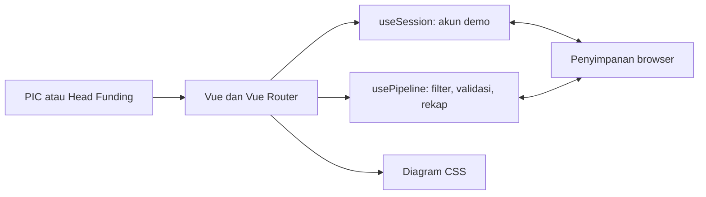
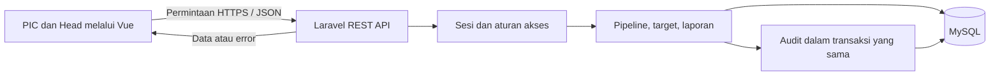
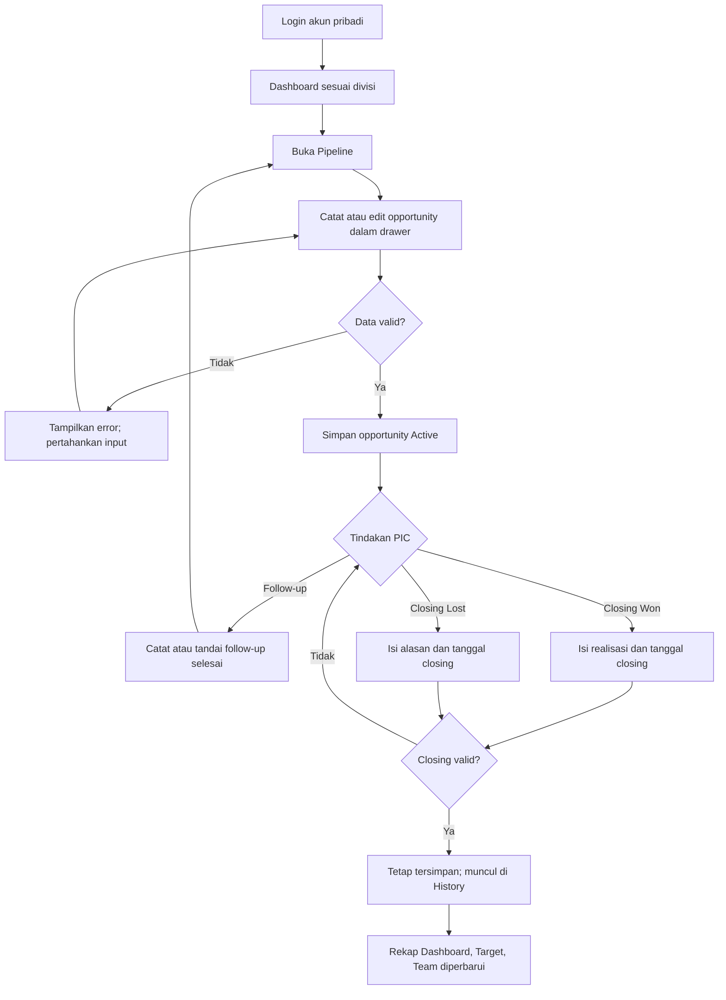
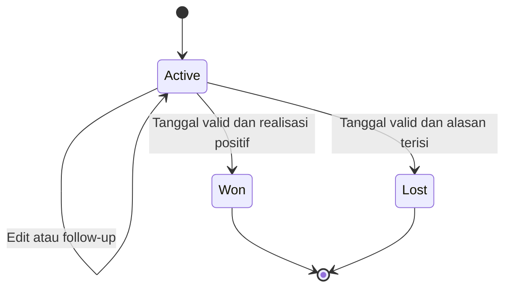
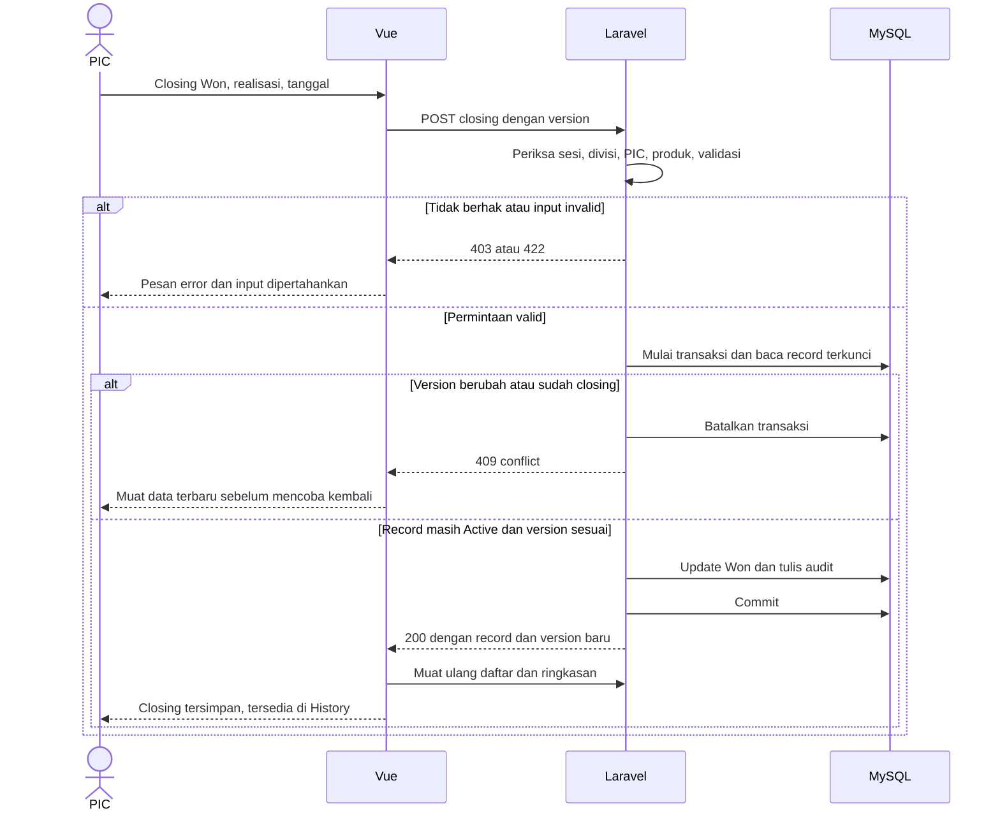

# Arsitektur dan alur proses

## 1. Arsitektur prototipe sebelum backend

Diagram ini disimpan sebagai catatan arsitektur lama. Penyimpanan operasional browser sudah digantikan oleh API dan MySQL.

## 2. Arsitektur saat ini — sudah diterapkan

Laravel menangani login token, validasi divisi/produk, transaksi, audit, serta akses MySQL. Vue menangani tampilan, input, dan respons error. CSS tetap menangani grafik. Docker tidak diperlukan untuk lingkungan Laragon ini.

## 3. Diagram konteks dan use case

| Aktor | Mengirim ke sistem | Menerima dari sistem |
|---|---|---|
| PIC Konsumer | Login; pipeline divisi; target dana; target/realisasi unit Konsumer; CMS | Dashboard, daftar aktif/closed, statistik PIC, hasil validasi |
| PIC Komersil | Login; pipeline divisi termasuk Giro; target dana; CMS | Dashboard/History/Team Komersil dan CMS; tanpa kartu QRIS/Bale Syariah |
| Head Funding | Login; pilihan divisi; perubahan setelah memilih satu divisi; perubahan CMS bersama | Laporan per divisi/gabungan dan history lintas divisi |

Diagram ini adalah konteks sistem, bukan DFD fisik database. Semua aktor berinteraksi dengan satu sistem melalui lima halaman yang ada. Administrator akun belum menjadi role terpisah; pemilik kewenangan pengelolaan akun perlu diputuskan.

## 4. Aktivitas PIC — perilaku yang sudah ada

Follow-up selesai tidak membuat opportunity Won. Opportunity yang selesai tidak dihapus. Interest Cold/Warm/Hot dapat berubah selama Active; tidak ada kewajiban melewati ketiganya secara berurutan.

## 5. State opportunity

Won/Lost adalah status akhir versi saat ini. State diagram tidak berarti record dihapus ketika mencapai akhir. Tahapan Prospect/Qualification/Proposal/Negotiation tidak ada pada implementasi saat ini.

## 6. Sequence closing — rancangan API

Belum ada transaksi dan version conflict server saat ini. Ini usulan untuk mencegah dua pengguna menutup/mengubah opportunity yang sama secara bersamaan.

## 7. Aturan perhitungan untuk review

| Ukuran | Dasar perhitungan |
|---|---|
| Pipeline aktif | Outcome Active, mengikuti divisi, seluruh tahun pencatatan |
| Nominal aktif | SUM nominal pipeline Active |
| Hot opportunity | Jumlah Active dengan interest Hot |
| Realisasi dana tahunan | SUM realization Won berdasarkan tahun `closed_date` |
| Realisasi dana bulanan | SUM realization Won berdasarkan tahun dan bulan closing |
| Achievement | Realisasi / target × 100; NULL jika target nol |
| Remaining | MAX(0, target − realisasi) |
| Konsolidasi produk | Penjumlahan Tabungan + Giro jika tersedia + Deposito pada scope terpilih |
| Realisasi unit tahunan | SUM total unit bulanan yang dimasukkan manual |
| CMS gabungan | Ambil scope shared sekali, tidak dijumlah per divisi |
| Statistik PIC | Aktif seluruh tahun; Won/Lost/realisasi mengikuti tahun closing dan PIC final |
| History PIC | Semua opportunity pernah ditangani, bukan hanya opportunity yang sedang ditangani |
| Rata-rata harian | Realisasi bulan / hari berlalu bulan berjalan; bulan lampau memakai jumlah hari penuh; bulan mendatang belum memiliki rata-rata |

Definisi tanggal hari ini mengikuti perangkat pada prototipe. Server usulan memakai zona waktu bisnis yang disepakati, agar laporan konsisten di setiap perangkat. Target Bekasi dan data unit Komersil lama tetap menjadi keputusan terbuka pada dokumen evaluasi.
